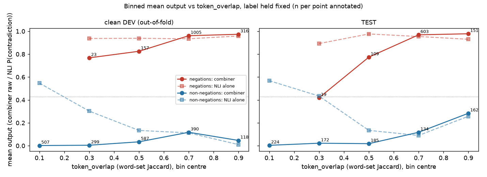

# Report F2: the overlap shortcut, an out-of-distribution validation slice, DeBERTa, family-rebalanced data, affirmation coverage, conditionals, severity

*Written for a reader who has read `report_f1.md` and nothing else. Built one step per commit; the step
log (section 14) is the running record, and sections 1–13 summarise it at the end.*

*Conventions, as in `report_f1.md`:*

- *TEST = CANNOT phase 2 test (1,400) + xNot360 (360) = 1,760 pairs (883 negations, 877 non-negations).*
- *VALIDATION = 601 CANNOT phase-2 pairs. `val_ood` = the out-of-distribution validation slice built in
  step 0.3. Clean DEV = `data/dev_clean.csv`, 3,402 pairs.*
- *K1 = 91 generator cancellation pairs (**machine-generated**), a held-out slice.*
- *Every threshold is fit on clean DEV.*
- *`token_overlap` (or "overlap") is the word-set Jaccard overlap of A and B, the combiner's own feature.*
- *Accuracy, precision, recall, F1, FPR and AUC are defined as in `report_f1.md`.*
- *95% CIs are percentile bootstraps over pairs (2,000 resamples, seed 0). p-values are two-sided paired
  permutation tests (10,000 permutations, seed 0), **not corrected for multiple comparisons**.*
- *Every TEST read is logged in `experiments/f2/results/test_reads.json`.*
- *"Phase 0 baseline" means `report_f1.md`'s adopted configuration: the 17-feature GBM with the
  cancellation override, threshold 0.428. "NLI alone" means `cross-encoder/nli-deberta-v3-base`
  P(contradiction) ≥ 0.975, its clean-DEV Youden threshold.*

## 14. Step log

### 0.1 The overlap analysis — the rewording weakness is real on human-written data, and so is the reason for it

`experiments/f2/overlap.py --step 0.1` → `experiments/f2/results/0_1_overlap.json`. Every TEST pair is
binned by `token_overlap`, both by quintiles of its own distribution and by fixed width. In each bin the
Phase 0 baseline combiner is compared with NLI alone. On clean DEV the combiner's predictions are
**out-of-fold**, because the final model has seen every DEV pair. All TEST pairs are human-written.

**TEST negations (n = 883): recall.**

| overlap bin (quintiles) | n | CANNOT / xNot360 | combiner recall | NLI-alone recall | combiner − NLI | p |
| --- | ---: | --- | ---: | ---: | ---: | ---: |
| 0.188–0.611 | 174 | 122 / 52 | **81.0%** | **90.8%** | **−9.8 pts** | 0.008 |
| 0.611–0.688 | 167 | 154 / 13 | 97.6% | 92.2% | +5.4 pts | 0.012 |
| 0.688–0.750 | 179 | 153 / 26 | 97.8% | 92.7% | +5.0 pts | 0.005 |
| 0.750–0.778 | 158 | 96 / 62 | 99.4% | 96.8% | +2.5 pts | 0.22 |
| 0.778–1.000 | 205 | 178 / 27 | 98.5% | 92.7% | +5.9 pts | 0.002 |

| overlap bin (fixed width) | n | combiner recall | NLI-alone recall | combiner − NLI | p | CANNOT phase 2 only: n, comb / NLI | xNot360 only: n, comb / NLI |
| --- | ---: | ---: | ---: | ---: | ---: | --- | --- |
| 0.0–0.2 | 1 (n < 50) | 0.0% | 100.0% | — | 1.0 | — | 1: 0% / 100% |
| 0.2–0.4 | 19 (n < 50) | **47.4%** | **84.2%** | **−36.8 pts** | 0.039 | 6: 100% / 83.3% | 13: **23.1% / 84.6%** |
| 0.4–0.6 | 109 | **80.7%** | **95.4%** | **−14.7 pts** | 0.0007 | 72: 88.9% / 97.2% (p = 0.032) | 37: 64.9% / 91.9% |
| 0.6–0.8 | 603 | 98.2% | 93.5% | +4.6 pts | 0.0001 | 482: 97.7% / 92.5% | 121: 100% / 97.5% |
| 0.8–1.0 | 151 | 98.7% | 90.1% | +8.6 pts | 0.0003 | 143: 98.6% / 89.5% | 8: 100% / 100% |

**TEST non-negations (n = 877): FPR**, i.e. how often each method wrongly calls a non-negation a negation.

| overlap bin (fixed width) | n | combiner FPR | NLI-alone FPR | combiner − NLI | p |
| --- | ---: | ---: | ---: | ---: | ---: |
| 0.0–0.2 | 224 | **0.0%** | **52.2%** | −52.2 pts | 0.0001 |
| 0.2–0.4 | 172 | 1.2% | 40.7% | −39.5 pts | 0.0001 |
| 0.4–0.6 | 185 | 0.5% | 10.8% | −10.3 pts | 0.0001 |
| 0.6–0.8 | 134 | 11.2% | 9.0% | +2.2 pts | 0.46 |
| 0.8–1.0 | 162 | 27.8% | 24.7% | +3.1 pts | 0.066 |

(Quintile bins for non-negations say the same thing and are in the JSON.)

**Verdict, in plain language: yes, the combiner's advantage over NLI reverses as overlap falls. The
rewording finding is confirmed on human-written pairs, and is now this report's headline.**

- **Above overlap 0.6**, the combiner catches 5–9 pts more negations than NLI alone (754 negations).
- **Below 0.6**, it catches **15 pts fewer** (80.7% vs 95.4% on 109 negations, p = 0.0007), and **37 pts fewer
  below 0.4** (47.4% vs 84.2%, n = 19, a small slice).
- In the bottom TEST quintile (n = 174) it is 81.0% against 90.8% (p = 0.008).
- The effect is largest on xNot360, but it is also present on CANNOT alone: 88.9% vs 97.2% at 0.4–0.6,
  n = 72, p = 0.032.

**The other half of the result matters just as much: the overlap feature is not only a shortcut, it is
the reason the combiner beats NLI at all.** Among non-negations with overlap below 0.4 (n = 396, mostly
random pairs, STS-low and SNLI neutral), NLI alone calls **41–52%** negations and the combiner calls
**0–1%**. The combiner learned "low overlap ⇒ not a negation" because in its training data low overlap
almost always meant an unrelated sentence. That is right for unrelated pairs and wrong for reworded
negations, and the training data never forced it to tell the two apart. **Any fix must keep the
protection against unrelated pairs while removing the penalty on related rewordings.** Simply trusting
NLI at low overlap would reintroduce a 40–50% false-positive rate there.

**The named human-written slices** (n printed; the brief's list, measured):

| slice | n | metric | combiner | NLI alone | p |
| --- | ---: | --- | ---: | ---: | ---: |
| TEST negations, overlap < 0.4 | 20 (n < 50) | recall | **45.0%** | **85.0%** | 0.024 |
| TEST negations, overlap 0.4–0.6 | 109 | recall | 80.7% | 95.4% | 0.0007 |
| TEST negations, bottom two quintiles (overlap < 0.688) | 357 | recall | 89.1% | 91.3% | 0.31 |
| TEST CANNOT antonym-substitution negations | 95 | recall | 92.6% | 88.4% | 0.39 |
| clean DEV antonym-substitution negations (combiner out-of-fold) | 208 | recall | 95.2% | 94.7% | 1.0 |
| SemAntoNeg paraphrases, phase 2 | 41 (n < 50) | FPR | 0.0% | 0.0% | 1.0 |
| clean DEV CANNOT phase-1 negations, overlap < 0.4 (out-of-fold) | 23 (n < 50) | recall | 82.6% | 91.3% | 0.51 |
| clean DEV CANNOT phase-1 negations, overlap 0.4–0.6 (out-of-fold) | 157 | recall | 87.3% | 91.1% | 0.19 |
| clean DEV CANNOT phase-1 negations, overlap ≥ 0.8 (out-of-fold) | 316 | recall | 97.8% | 95.2% | 0.009 |
| clean DEV CANNOT phase-1 non-negations, overlap < 0.4 (out-of-fold) | 109 | FPR | 0.0% | 2.8% | 0.26 |

**Correction to the brief.** The brief lists the CANNOT antonym-substitution subset as "lexically
divergent by construction". It is not. An antonym substitution swaps one word, so its overlap is high:
median 0.667 on TEST (n = 95) and on clean DEV (n = 208), with only 6.3% / 9.6% below 0.4. On that subset
the combiner is level with or ahead of NLI. **It is not evidence about rewording either way**, and the
report does not use it as such. SemAntoNeg is low-overlap (median 0.40, n = 41), but it consists of
non-negations, and both methods reject all of them. The clean-DEV low-overlap tail points the same way as
TEST (82.6% vs 91.3% below 0.4, 87.3% vs 91.1% at 0.4–0.6), but the differences are not significant. **The
rewording claim rests on the TEST low-overlap negations: n = 129 below 0.6, n = 20 below 0.4.**

**Where the benchmarks and the application sit:**

| pairs | n | median overlap | share < 0.4 | share < 0.6 |
| --- | ---: | ---: | ---: | ---: |
| CANNOT phase 2 negations (TEST) | 703 | 0.714 | 0.9% | 11.1% |
| xNot360 negations (TEST) | 180 | 0.733 | 7.8% | 28.3% |
| clean DEV CANNOT phase-1 negations (training data) | 1,501 | 0.700 | 1.5% | 12.0% |
| CANNOT phase 2 non-negations (TEST) | 697 | 0.375 | 52.8% | 76.5% |
| paragraph set, gold contradicted pairs (**machine-authored**) | 11 (n < 50) | 0.539 | 45.5% | 54.5% |
| paragraph set, gold covered pairs (**machine-authored**) | 72 | 0.304 | 63.9% | 93.1% |
| model-written placeholder, negations | 10 (n < 50) | 0.437 | 40.0% | 70.0% |
| domain answers, negation category (**machine-generated**) | 458 | 0.926 | 0.0% | 0.0% |
| domain answers, paraphrase category (**machine-generated**) | 484 | 0.833 | 0.2% | 2.3% |

**The claim holds for written answers and fails for generated ones.**

- The training data and both benchmarks place negations at high overlap: only 1–8% fall below 0.4.
- Non-negations sit low: 53% of CANNOT's non-negations fall below 0.4.
- Both written-answer sets place negations much lower: about 40–45% below 0.4. These are model-written,
  so they show the *shape* of rewording, not its frequency in real classrooms.
- The **generator's** negations sit even higher than CANNOT's (median 0.926). That is why
  `report_f1.md`'s machine-generated domain study saw 95.6% recall and missed the problem: it tested the
  shortcut on data that satisfies it.

```sh
./venv/bin/python experiments/f2/overlap.py --step 0.1
```

### 0.2 The mechanism, visible in the model

`experiments/f2/overlap.py --step 0.2` → `results/0_2_mechanism.json`, `docs/figures/overlap_mechanism.png`.

Phase 0 baseline GBM importances (unchanged from `report_f1.md`):

| feature | importance |
| --- | ---: |
| `p_contradiction` | 0.537 |
| **`token_overlap`** | **0.327** |
| `cos_sim` | 0.044 |
| `len_a` | 0.022 |
| `antonym_aligned` | 0.020 |

Every other feature is at or below 0.015.

**Partial dependence of the GBM on `token_overlap`** (log-odds, averaged over clean DEV): a step
function. It is flat at about **−4.4 for overlap ≤ 0.47**, rises to −3.5 at 0.51, and then **jumps to −0.28 at
0.556 and +0.80 at 0.60**, a swing of about 4.3 log-odds across one tenth of the overlap range. Above
that it stays at +0.8 to +1.3. The model has, in effect, learned a hard cut near overlap 0.55.



**Mean output by overlap bin, label held fixed** (combiner raw output vs NLI P(contradiction); n per bin):

| | 0.2–0.4 | 0.4–0.6 | 0.6–0.8 | 0.8–1.0 |
| --- | --- | --- | --- | --- |
| TEST negations: combiner / NLI | **0.42** / 0.89 (n = 19) | **0.77** / 0.98 (n = 109) | 0.97 / 0.95 (n = 603) | 0.98 / 0.93 (n = 151) |
| clean DEV negations, out-of-fold: combiner / NLI | 0.77 / 0.94 (n = 23) | 0.83 / 0.94 (n = 157) | 0.96 / 0.93 (n = 1,005) | 0.97 / 0.96 (n = 316) |
| TEST non-negations: combiner / NLI | 0.02 / 0.43 (n = 172) | 0.02 / 0.13 (n = 185) | 0.12 / 0.09 (n = 134) | 0.28 / 0.26 (n = 162) |

**Among true negations, the combiner's output rises with overlap while NLI's does not.** That is
the shortcut made visible. On TEST negations, the combiner's mean falls from 0.98 to 0.42 as overlap drops,
while NLI stays between 0.89 and 0.98. Among non-negations the picture reverses: NLI's output climbs as
overlap falls (0.43 at 0.2–0.4, 0.57 below 0.2), and the combiner holds it near 0. The same cut that costs
recall on reworded negations buys the precision on unrelated pairs (step 0.1).

```sh
./venv/bin/python experiments/f2/overlap.py --step 0.2
```

### 0.3 `val_ood`: an out-of-distribution validation slice, and the selection rule for this round

`experiments/f2/val_ood.py` → `data/val_ood.csv`, `results/0_3_val_ood.json`. Built from **MNLI
validation** (matched + mismatched; GLUE revision `bcdcba79`, sha256-verified via
`experiments/f2/fetch_data.py`). MNLI is in no earlier split. The builder **asserts that no sentence
(normalised) appears in TEST, VALIDATION or clean DEV**. Everything in it is human-written.

| section | label | n | median overlap | how chosen |
| --- | ---: | ---: | ---: | --- |
| MNLI contradiction | 1 (negation) | 400 | 0.263 | premise and hypothesis each one sentence, 5–40 words; overlap < 0.6; mpnet cosine ≥ 0.6 (same topic); random 400 (seed 0) |
| MNLI entailment | 0 | 200 | 0.268 | same filters, sampled to match the positives' overlap in 0.1-wide bins |
| MNLI neutral | 0 | 200 | 0.263 | same |
| synthetic conditionals (**machine-generated**) | rule-derived | — | — | appended in step 5.1 |

**Departures from the brief, with reasons:**

1. **Same-topic and overlap-matched, not raw low-overlap contradictions.** An MNLI or SNLI contradiction
   is not the same thing as a negation. At low overlap many contradictions are simply different events,
   and clean DEV labels those *not a negation* (its SNLI-neutral and STS-low pairs). The cosine floor keeps
   same-topic pairs. Matching negatives on overlap means a model cannot score well on `val_ood` by
   reading overlap. **The labels are still MNLI's, and "contradiction" remains broader than CANNOT's
   "negation". `val_ood` accuracies are read with that in mind.** Examples: *Sorry but that's how it is.* /
   *This is how things are and there are no apologies about it.* (contradiction, reworded); *When a
   baseball player is removed by the manager, the organist plays Auld Lang Syne.* / *There is no organ
   music when the manager has to remove a baseball player.* (contradiction).
2. **SNLI not used.** Its contradictions are mostly image-caption event mismatches (*A man is sleeping* /
   *A man is running*), the kind of pair clean DEV labels as not a negation.
3. **No CANNOT phase-1 pairs moved out of clean DEV.** Moving them would mean retraining everything. MNLI
   supplied enough low-overlap pairs without it.
4. **A fixed fit / select split.** The brief asks Phase 1 to fit θ and ρ on clean DEV plus `val_ood`, and then
   to select on `val_ood`, which would select on the data the parameters were fit to. So every row gets a
   fixed half by sha1 hash of the pair. The **fit** half (417 rows: 209 / 106 / 102) may be used for
   fitting. The **select** half (383 rows: 191 / 94 / 98) is used only for the selection rule. **"val_ood"
   in every table means the select half** unless marked otherwise.

**Selection rule for the rest of this round, stated before any Phase 1 run.** A change is adopted only if
**VALIDATION accuracy and `val_ood` (select-half) accuracy are both non-decreasing** against the current
adopted configuration. If one rises and the other falls, both are reported and the change is not
adopted. When several candidates pass, the one with the highest sum of the two gains is taken, with
clean-DEV accuracy as tie-break.

```sh
./venv/bin/python experiments/f2/fetch_data.py
./venv/bin/python experiments/f2/val_ood.py
```

### 0.4 The Phase 0 baseline, on TEST, VALIDATION and `val_ood`

`experiments/f2/eval2.py` → `results/0_4_baseline.json`. Every later row is measured against the first
row. Two columns are new:

- **low-ov neg recall:** recall on the 129 TEST negations with overlap < 0.6 (step 0.1's reversal region,
  human-written);
- **low-ov non-neg FPR:** FPR on the 396 TEST non-negations with overlap < 0.4, the protection against
  unrelated pairs that any fix must keep.

| configuration | phase-2 acc (95% CI) | all-TEST | xNot360 | precision | recall | F1 | FPR paraphrase | sts_low | snli_neutral | random_pair | xNot360 not_neg | antonym recall (n=95) | K1 FPR (n=91, machine-gen.) | low-ov neg recall (n=129) | low-ov non-neg FPR (n=396) | VAL | val_ood (select, n=383) |
| --- | --- | ---: | ---: | ---: | ---: | ---: | ---: | ---: | ---: | ---: | ---: | ---: | ---: | ---: | ---: | ---: | ---: |
| **Phase 0 baseline** | 97.7% (96.9–98.5) | 93.9% | 78.9% | 93.0% | 94.9% | 94.0% | 1.9% | 3.9% | 0.0% | 0.0% | 28.9% | 92.6% | 2.2% | **75.2%** | 0.5% | 97.8% | **59.8%** |
| NLI alone (reference) | 82.8% (80.9–84.6) | 81.8% | 77.8% | 76.0% | 93.0% | 83.7% | 0.3% | 70.9% | 2.6% | 78.1% | 40.0% | 88.4% | 4.4% | 93.8% | **47.2%** | 86.0% | 95.0% |

On `val_ood` (select half, n = 383: 191 contradictions, 192 entailment / neutral):

- **Phase 0 baseline:** recall **19.4%**, FPR 0.0%.
- **NLI alone:** recall 90.6%, FPR 0.5%.

On the fit half (n = 417) the figures are 18.2% / 0.0% and 86.6% / 1.4%.

**Out of distribution, the combiner misses four of every five reworded contradictions.** On
`val_ood` the overlap cut (step 0.2) rejects almost every same-topic pair below overlap 0.5, whatever NLI
says.

**A confound to keep in view for every later `val_ood` number.** `val_ood` is MNLI validation, and every
NLI cross-encoder in this project was trained on MNLI's *training* split (plus SNLI, and for DeBERTa-anli
also FEVER and ANLI). The validation pairs are unseen, but they come from the training distribution, so
NLI alone is close to its best here (95.0%). `val_ood` will reward any fix that trusts NLI more.
That is why the selection rule also requires VALIDATION not to fall. It is also why the TEST low-overlap
columns, CANNOT and xNot360 pairs that no model was trained on, are reported next to it as the
independent check.

```sh
./venv/bin/python experiments/f2/eval2.py
```

### 1.1 The low-overlap NLI override: the brief's rule fails; with a topic floor it works

`experiments/f2/override.py --step 1.1` → `results/1_1_rule_grid.json`.

- **The rule:** turn the combiner's "not a negation" into "negation" when `token_overlap < θ` and
  `P_contradiction > ρ`. It runs after the cancellation override, which it never undoes.
- **Fit:** θ and ρ maximise accuracy on clean DEV (combiner **out-of-fold**), pooled with the `val_ood`
  **fit** half (3,402 + 417 pairs).
- **Grid:** θ ∈ {0.3, 0.4, 0.5, 0.6, 0.7}, ρ ∈ {0.9, 0.95, 0.975, 0.99, 0.995, 0.999}.
- With no rule, pooled accuracy is **92.35%**.

**The brief's rule, as specified (no topic condition):** pooled accuracy, the whole surface.

| θ \ ρ | 0.9 | 0.95 | 0.975 | 0.99 | 0.995 | 0.999 |
| --- | ---: | ---: | ---: | ---: | ---: | ---: |
| 0.3 | 86.5% | 86.6% | 86.8% | 87.3% | 87.5% | 88.2% |
| 0.4 | 86.6% | 86.8% | 87.0% | 87.5% | 87.8% | 88.4% |
| 0.5 | 86.8% | 87.0% | 87.1% | 87.7% | 88.0% | **88.5%** |
| 0.6 | 86.1% | 86.3% | 86.5% | 87.2% | 87.6% | 88.2% |
| 0.7 | 85.9% | 86.2% | 86.4% | 87.1% | 87.6% | 88.2% |

**Every cell is below the no-rule 92.35%.** The rule as specified cannot help at any setting, which is
what step 0.1 predicted. Below overlap 0.4, NLI gives P(contradiction) above threshold to 41–52% of
unrelated pairs, so the override turns hundreds of clean-DEV random, STS-low and SNLI-neutral pairs into
false positives.

**The rule with a topic floor**, which this report adds: also require mpnet cosine(A, B) ≥ κ, so it fires
only on same-topic rewordings. Best cell per κ:

| κ | best θ, ρ | pooled accuracy | surface range |
| --- | --- | ---: | --- |
| none (the brief's rule) | 0.5, 0.999 | 88.5% | 85.9–88.5% |
| 0.5 | 0.5, 0.9 | 95.3% | 93.9–95.3% |
| **0.6** | **0.5, 0.9** | **95.65%** | 94.0–95.65% |
| 0.7 | 0.5, 0.9 | 93.9% | 92.9–93.9% |

Full surfaces for every κ are in the JSON. With the floor, the surface is flat in ρ (within 0.8 pts from
0.9 to 0.995), peaked at θ = 0.5, and κ matters most. **Caveat on κ:** `val_ood` was built with a cosine ≥
0.6 filter (step 0.3), so the κ = 0.6 floor never excludes a `val_ood` row. Part of κ = 0.6's advantage
over 0.7 reflects that construction and not the data. On clean DEV alone the κ choice is driven by
STS-low and SNLI-neutral pairs. Step 1.3 tests all four κ rows on TEST, VALIDATION and the `val_ood`
select half.

```sh
./venv/bin/python experiments/f2/override.py --step 1.1
```
